# LocalLens — Community Issue Resolution Platform

LocalLens is a full-stack MERN application that connects local residents, volunteers, and municipal administrators to identify, report, track, and resolve neighborhood problems (damaged roads, garbage dumps, water pipe leakages, unlit streetlights, drainage blockages, and safety hazards).

The application is styled with the **Vibrant Community design system**: warm cream surfaces, coral primary accents, rounded cards, and responsive role-specific dashboards.

---

## Architecture Overview

```mermaid
flowchart LR
    subgraph Client ["Client (React 19 + Vite 8)"]
        UI["Vibrant Community UI"]
        AuthCtx["Auth Context + JWT Storage"]
        Leaflet["Leaflet + Heatmap View"]
        Charts["Recharts Analytics"]
    end

    subgraph Server ["Server (Express 5 + Node.js)"]
        AuthRoute["/api/auth (2-Step OTP)"]
        ReportRoute["/api/reports (Multer + Cloudinary)"]
        UserRoute["/api/users (Profile & Roles)"]
        NotifRoute["/api/notifications"]
    end

    subgraph DB ["Database & Third-Party APIs"]
        MongoDB[(MongoDB Atlas)]
        Cloudinary[(Cloudinary Storage)]
        Resend[Resend Email OTP]
        Twilio[Twilio SMS OTP]
    end

    Client --> Server
    Server --> DB
```



---

## Design System: Vibrant Community

* **Backgrounds**: Warm cream (`#FFF7ED`, `#FFFDF9`, `#FAF4EB`)
* **Primary / Accents**: Coral (`#F46B50`, hover `#DC5239`) and Golden Amber (`#FFB454`)
* **Typography**: Headings in `Manrope` (800 weight), body text in `DM Sans` (400, 500, 600, 700)
* **Surfaces**: Rounded corners (`border-radius: 16px`, `22px`), soft shadows (`0 8px 24px rgba(80, 45, 28, 0.06)`)
* **Unified Status Badges**:
  * `pending`: Amber warm badge
  * `verified`: Blue badge
  * `assigned`: Purple/violet badge
  * `in-progress`: Coral badge
  * `resolved`: Emerald/green badge
  * `rejected`: Rose/crimson badge

---

## Role Matrix & Capabilities

| Feature | Citizen | Volunteer | Administrator |
| :--- | :---: | :---: | :---: |
| **Browse Reports & Map** | Yes | Yes | Yes |
| **Submit New Issue with Photos** | Yes | Yes | Yes |
| **Track Own Reports** | Yes | — | — |
| **View Assigned Field Tasks** | — | Yes | — |
| **Start Progress & Resolve (with Note)** | — | Yes | Yes |
| **Toggle Availability for Tasks** | — | Yes | — |
| **Verify / Reject Reports** | — | — | Yes |
| **Assign Volunteers to Reports** | — | — | Yes |
| **Civic Analytics & Trends Dashboard** | — | — | Yes |
| **Activity Notifications & Bell** | Yes | Yes | Yes |

---

## Getting Started

### Prerequisites
* Node.js `>= 20.19.0`
* MongoDB Atlas or local MongoDB instance

### 1. Environment Configuration

The backend reads configuration from `server/.env`:

```env
PORT=5001
MONGO_URI=mongodb+srv://<username>:<password>@cluster.mongodb.net/locallens
JWT_SECRET=your-minimum-32-character-secret-key-goes-here
CLIENT_URL=http://localhost:5173

# Cloudinary (Photo Uploads)
CLOUDINARY_CLOUD_NAME=your_cloud_name
CLOUDINARY_API_KEY=your_api_key
CLOUDINARY_API_SECRET=your_api_secret

# Resend (Email OTPs)
RESEND_API_KEY=your_resend_api_key
EMAIL_FROM=onboarding@resend.dev

# Twilio (SMS OTPs via Verify v2)
TWILIO_ACCOUNT_SID=your_account_sid
TWILIO_AUTH_TOKEN=your_auth_token
TWILIO_VERIFY_SERVICE_SID=your_verify_service_sid
```

The client reads configuration from `client/.env`:
```env
VITE_API_URL=http://localhost:5001/api
```

---

### 2. Installation & Running

#### Option A: One-Command Start (Whole Project Together):
From the project root:
```bash
# Start both backend server (port 5001) and frontend client (port 5173) together
npm run dev
```

#### Option B: Start Separately:

* **Backend Server** (Port `5001`):
  ```bash
  cd server
  npm run dev
  ```

* **Frontend Client** (Port `5173`):
  ```bash
  cd client
  npm run dev
  ```
  *Client runs on [http://localhost:5173](http://localhost:5173).*

---

### 3. Database Seeding & Admin Creation

#### Seed Demo Data (5 test accounts + 8 realistic reports + history):
```bash
cd server
npm run seed
```
**Demo Accounts** *(Password for all: `Password123!`)*:
* **Admin**: `admin@locallens.test`
* **Volunteer 1**: `volunteer.rahul@locallens.test`
* **Volunteer 2**: `volunteer.priya@locallens.test`
* **Citizen 1**: `citizen.anita@locallens.test`
* **Citizen 2**: `citizen.vikram@locallens.test`

#### Promote Any Existing User to Admin:
```bash
cd server
npm run make-admin -- your-registered-email@example.com
```

---

### 4. Quality & Build Verification

* **Frontend Linting**:
  ```bash
  cd client
  npm run lint
  ```
  *(Ensures 0 ESLint errors and 0 warnings)*

* **Production Build**:
  ```bash
  cd client
  npm run build
  ```
